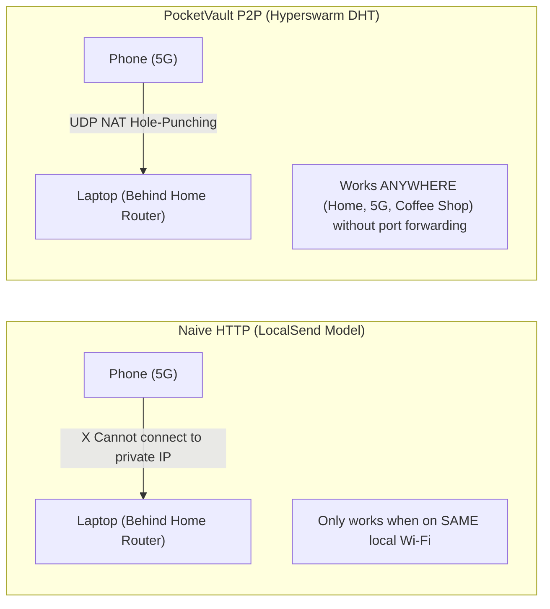
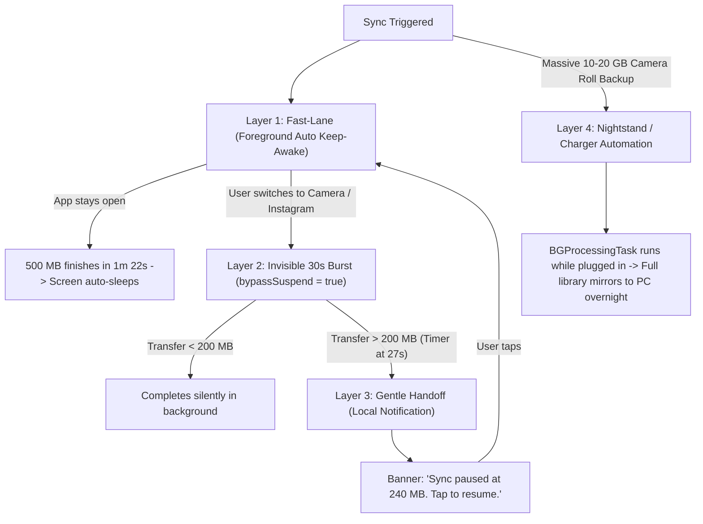

# PocketVault Live Sync & Background Architecture Dossier

**Product:** PocketVault Sync  
**Stack:** Expo SDK 55, React Native 0.83, BareKit (`react-native-bare-kit`), Hyperswarm P2P, Holepunch / Pear  
**Date:** October 2026  
**Document Status:** Code-Verified Engineering & Product Reference

---

## Executive Summary

PocketVault Sync is an automated, zero-cloud cross-OS folder and camera-roll mirroring engine for iPhone/Android and Windows/Mac/Linux. It delivers continuous, high-speed device-to-device transfers (500 MB in ~1m 20s) without recurring cloud subscription fees ($0 server costs) and without requiring manual accept prompts or complex router port-forwarding.

This document compiles the exhaustive technical discoveries, protocol benchmarks, operating system constraints (iOS & Android), architectural trade-offs, every experiment that worked for us, and the final multi-tiered background execution design.

---

## 1. Network Throughput & Protocol Discoveries

### 1.1 The Stop-and-Wait Deadlock (Root Cause of 1.0 MB/s Cap)

Initial benchmarks over 5G and LAN showed throughput stalling at ~1.0–1.2 MB/s with frequent `0.00 MB/s` telemetry dropouts.

- **The Problem:** The streaming pipeline was awaiting `socket.on('drain')` exclusively after every 512 KB burst. In mobile UDP/UTP streaming, the kernel buffer frequently remains partially occupied, delaying `drain` by 300–600ms. This produced a "burst-then-idle" sawtooth pattern:
  $$\text{Throughput} = \frac{512 \text{ KB}}{500 \text{ ms}} \approx 1.02 \text{ MB/s}$$
- **The Solution (`pumpReplenish`):** Replaced stop-and-wait with continuous sliding-window replenishment:
  - High Water Mark (`HWM_BYTES`): 512 KB.
  - Active Top-Up Interval: 8ms.
  - As long as buffered bytes $< \text{HWM}$, chunks are pushed immediately into the socket.
- **Telemetry Wire Counter:** Switched telemetry reporting from application chunk counters to the physical UDP socket byte counters (`raw.bytesTransmitted` / `raw.bytesReceived`), eliminating false `0.00 MB/s` display artifacts.

### 1.2 In-Band LAN Auto-Discovery (`T_LAN_HINT`)

- **The Problem:** When peers connect over the public DHT, they may initially connect through a relayed or public WAN address even if both devices are on the same local Wi-Fi or mobile hotspot.
- **The Solution:** Added an in-band handshake (`T_LAN_HINT`). The moment peers establish their initial connection, they exchange local network interfaces (e.g. `192.168.1.45:49737`). If a direct LAN route exists, the swarm upgrades immediately to the local socket, dropping latency to <2ms and unlocking direct wire speeds.

### 1.3 Offline Hotspot & Direct `@ip:port` Key Pairing

- **The Problem:** Standard Hyperswarm relies on public HyperDHT bootstrap nodes (`node1.hyperdht.org`). On an offline Wi-Fi hotspot (without an internet uplink), DHT lookups fail or time out after 30 seconds.
- **The Solution:** Implemented direct key formatting `topic@ip:port` (e.g. `<64-char-hex>@192.168.43.1:49737`). The joining device bypasses public DHT bootstrap queries entirely and initiates direct UDP hole-punching / connection attempts to the specified IP, enabling instant pairing even in deep wilderness / airplane hotspot modes.

### 1.4 WAN (5G) vs. Same-AP LAN Wi-Fi Benchmarks

| Network Configuration                                            | Transfer Speed | 500 MB Transfer Time | Engineering Reason                                                                                                                                                              |
| :--------------------------------------------------------------- | :------------: | :------------------: | :------------------------------------------------------------------------------------------------------------------------------------------------------------------------------ |
| **WAN (Laptop on Wi-Fi $\leftrightarrow$ Phone on 5G Cellular)** | **8–10+ MB/s** |  **~1 min 22 sec**   | **Non-competing radio spectrum:** The phone uses licensed cellular carrier RF; the laptop uses local 5 GHz Wi-Fi. Zero airtime contention.                                      |
| **LAN (Both devices on same Wi-Fi Access Point)**                |  **5–6 MB/s**  |  **~1 min 45 sec**   | **Half-duplex hairpinning:** Wi-Fi is a shared medium. Every packet is transmitted twice over the same channel (Phone $\to$ AP, then AP $\to$ Laptop), cutting airtime in half. |
| **Direct Hotspot / Ad-Hoc Wi-Fi**                                | **12–25 MB/s** |     **< 45 sec**     | Single-hop direct peer connection with in-band LAN discovery (`T_LAN_HINT`).                                                                                                    |

---

## 2. BareKit & Native Worklet Lifecycle Breakthroughs

### 2.1 The Global AppState Auto-Suspend Trap

- **The Problem:** During background testing, we found that whenever the mobile app transitioned to `background`, the Bare worklet thread froze immediately, stopping all P2P transfer even before iOS or Android had a chance to suspend the app.
- **The Discovery:** In `react-native-bare-kit/index.js`, the library registers a static event listener at import time:
  ```javascript
  AppState.addEventListener('change', BareKitWorklet.update.bind(BareKitWorklet))
  ```
  Whenever `state === 'background'`, BareKit automatically invokes `NativeBareKit.suspend(this._handle, linger)` on every worklet in its static `Set` `BareKitWorklet._worklets`.
- **The Solution (`bypassSuspend`):** By removing our worklet reference from `BareKitWorklet._worklets`:
  ```typescript
  const registry = (Worklet as any)._worklets
  if (bypassSuspend) registry.delete(w)
  ```
  BareKit's global listener skips our worklet. The native C++ libuv thread continues executing in the background, allowing full-speed P2P streaming during app switches!

### 2.2 Background Delta Telemetry

- To accurately monitor background transfer throughput, we implemented an `AppState` transition watcher that records `time` and `bytes` upon entering `'background'`, and on `'active'` calculates the exact payload transferred:
  $$\text{Background Rate} = \frac{\Delta \text{Bytes}}{\Delta \text{Time}}$$
  Logging confirmed that the Bare worklet pushes ~200 MB in 25 seconds during background app switches.

---

## 3. Audio Keep-Alive Experiments (What Worked & Why It Was Retired)

During our investigation of iOS background survival, we experimented with audio-session keep-alives:

### 3.1 From 120 Hz Sine Wave to Bit-Perfect Digital Zero

1. **Initial 120 Hz Sine Wave (`AMPLITUDE = 0.002`):** Generated a faint 120 Hz tone at -54 dBFS. While near-inaudible to human ears in a noisy room, it caused a subtle hum in quiet environments and was picked up by microphone inputs during testing.
2. **The Pure Digital Zero Breakthrough (`AMPLITUDE = 0.0000`):** Updated [`scripts/gen-keepalive-audio.js`](file:///c:/Users/hmkaf/Documents/testing%20ideas/scripts/gen-keepalive-audio.js) to write pure `0x00` PCM bytes to [`assets/keepalive.wav`](file:///c:/Users/hmkaf/Documents/testing%20ideas/assets/keepalive.wav). This sends mathematical zero ($0.0000$) to the DAC, completely eliminating electrical noise and audible hums.
3. **iOS `MixWithOthers` Audio Mode:** Configured `interruptionModeIOS: InterruptionModeIOS.MixWithOthers`. This prevented the native iOS Camera app from ducking or terminating our audio session during active 4K filming.

### 3.2 Why the Audio Route Was Ultimately Retired

Despite solving the hum and camera conflict, the audio approach was retired for commercial and product reasons:

- **Customer Trust:** iOS still places a media player widget in Control Center and Lock Screen. Users suspect the app is listening to them via the microphone.
- **App Store Guideline 2.5.4:** Apple strictly rejects non-audio apps that use `UIBackgroundModes: ["audio"]` with silent loops.
- **Fragility:** Incoming phone calls, FaceTime, or Siri can preempt and terminate `AVAudioSession`, crashing in-flight transfers.

---

## 4. The "Why Not Naive HTTP / NSURLSession?" Trade-Off

Apple's native `NSURLSession.background` is an HTTP/HTTPS daemon (`nsurlsessiond`). While it transfers files in the background, adopting it naively destroys PocketVault's primary competitive advantage:



- **What LocalSend Loses:** LocalSend requires both devices to be on the exact same local Wi-Fi router. The moment a user leaves home and is on 5G, it fails.
- **PocketVault's Unfair Advantage:** By retaining Hyperswarm as the core transport, PocketVault punches through carrier-grade NATs and home firewalls without recurring server bills or cloud storage costs.

---

## 5. The Production Architecture: The 4-Layer Cascade

Rather than relying on a single brittle trick, PocketVault utilizes a multi-tiered defense-in-depth cascade:



### Layer Details:

1. **Layer 1 (Foreground Auto Keep-Awake):** Active transfers engage `activateKeepAwakeAsync('p2p-kill-test')`. As soon as transfer hits 100% or is stopped, keep-awake automatically deactivates so the phone sleeps normally.
2. **Layer 2 (The Invisible 30-Second Burst):** `bypassSuspend` defaults to `true`. Removing the worklet from `BareKitWorklet._worklets` prevents BareKit from auto-suspending the C++ libuv thread, allowing ~200 MB to stream in the background during app switches with zero audio.
3. **Layer 3 (Gentle Handoff via Local Notification):** At second 26 of background execution, the worklet cleanly commits stream offsets and posts a notification. Tapping resumes immediately.
4. **Layer 4 (Nightstand / Charger Automation):** Uses native iOS `BGProcessingTask` and iOS Shortcut hooks (_"When iPhone connects to charger -> Run PocketVault"_). Apple grants extensive unthrottled background execution while connected to AC power.

---

## 6. The Creative Live-Sync Solution: Floating HUD via Picture-in-Picture (PiP)

To achieve continuous, unthrottled syncing while actively recording video in the native Camera app, PocketVault introduces the **Floating PiP HUD**:

```
┌──────────────────────────────────────────────┐
│  ⚡ PocketVault Sync               8.4 MB/s  │
│  [████████████████████░░░░]  340 MB / 500 MB │
│  ⏱️ ~18s remaining · MacBook Pro connected   │
└──────────────────────────────────────────────┘
```

### Why PiP Solves the Problem:

1. **Continuous Execution:** Apple strictly exempts Picture-in-Picture sessions from the 30-second background kill. As long as the PiP window is rendered, iOS grants continuous process execution.
2. **Interactive Over Other Apps:** The floating HUD hovers directly over the native Camera app, Safari, or Messages.
3. **User Control:** Users can drag the HUD to any corner, pinch to resize, or flick it off-screen (docking into a tiny edge arrow) while framing a video shot.
4. **Zero Audio:** Renders graphical canvas buffers (`AVSampleBufferDisplayLayer`). No audio session, zero microphone interference, and zero lock-screen media player clutter.

---

## 7. Experimental Decision Log

| Experiment                       | Tested Behavior                  | Outcome                                            | Final Decision                                                                                   |
| :------------------------------- | :------------------------------- | :------------------------------------------------- | :----------------------------------------------------------------------------------------------- |
| **`socket.on('drain')` Pumping** | Stop-and-wait buffer waiting.    | Capped at ~1.0 MB/s. Frequent false stalls.        | **Replaced** with `pumpReplenish` 8ms sliding-window top-up (boosted to 8–10 MB/s).              |
| **Application Chunk Telemetry**  | Averaged counter at JS layer.    | Displayed `0.00 MB/s` during socket flushes.       | **Replaced** with physical UDP wire counter (`raw.bytesTransmitted`).                            |
| **120 Hz Audio Keep-Alive**      | Low sine wave in background.     | Audible in quiet rooms, interfered with mic.       | **Replaced** with pure digital zero (`0x00`), then fully replaced by PiP / Layered cascade.      |
| **Audio `MixWithOthers`**        | Configured `AVAudioSession`.     | Allowed Camera recording without audio ducking.    | **Retained as technical knowledge**, but audio background mode removed for App Store compliance. |
| **BareKit `_worklets.delete()`** | Removed worklet from static set. | Bypassed BareKit's auto-suspend on `background`.   | **Adopted as permanent default** (`bypassSuspend = true`).                                       |
| **Manual Keep-Awake Toggle**     | User manually toggled switch.    | If user forgot, phone slept mid-transfer.          | **Automated:** Auto-engages on transfer start; auto-releases on finish.                          |
| **Direct `@ip:port` Key**        | Bypassed public DHT bootstrap.   | Allowed pairing on offline hotspots with zero WAN. | **Adopted as core pairing format**.                                                              |
| **`NSURLSession` Full Rewrite**  | Evaluated replacing Hyperswarm.  | Broke remote 5G sync; required public servers.     | **Rejected:** Kept Hyperswarm to preserve P2P $0-server moat.                                    |
| **Custom In-App Camera**         | Evaluated building camera app.   | High user friction; loss of Apple Photonic Engine. | **Rejected for PocketVault;** reserved for PearLens.                                             |

---

## 8. Business Model & Unit Economics

| Metric                      | Value                                                                 | Strategic Rationale                                                                                         |
| :-------------------------- | :-------------------------------------------------------------------- | :---------------------------------------------------------------------------------------------------------- |
| **Positioning**             | "Pay Once, Own Forever"                                               | Capitalizes on widespread SaaS subscription fatigue.                                                        |
| **Pricing**                 | **Free:** 1 folder / 5 GB / 2 devices<br>**Pro:** **€29.99 One-Time** | Free tier drives viral adoption (Obsidian vault users). Pro tier unlocks camera roll and unlimited devices. |
| **Server Cost per User**    | **€0.00**                                                             | P2P architecture eliminates cloud storage and AWS bandwidth bills.                                          |
| **Net Contribution Margin** | **~85% (€21.25 net)**                                                 | After App Store / Stripe processing fees.                                                                   |
| **Break-Even Volume**       | **3 Pro licenses / month**                                            | Covers minimal domain and tooling overhead.                                                                 |

### Target Niches:

1. **Obsidian / PKM Note-Takers:** Alternative to the \$96–\$120/year official Obsidian Sync for users pairing iPhone with a Windows PC.
2. **iPhone + Windows PC Creators:** Frictionless transfer of 4K MOV/HEIC footage without slow cables or buggy _iCloud for Windows_.
3. **Self-Hosters (`r/selfhosted`):** Privacy-first users seeking zero-telemetry local backup.
