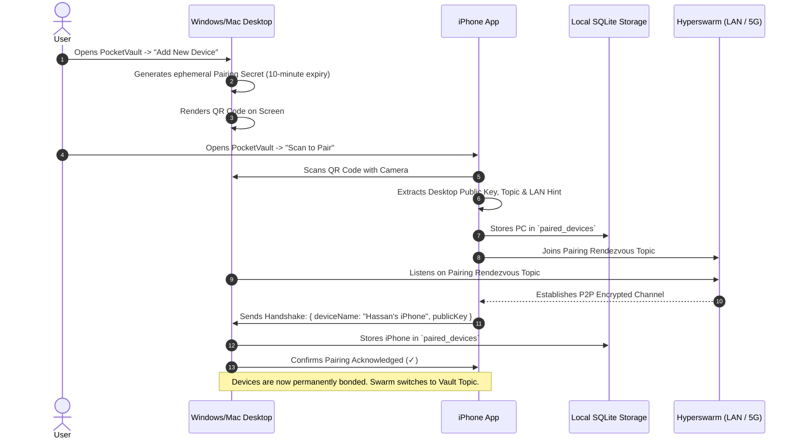

# PocketVault Persistent Pairing & Device Identity Architecture

**Product:** PocketVault Sync  
**Component:** Persistent Pairing Layer & Device Identity Engine  
**Stack:** Hyperswarm, Hypercore Crypto (Ed25519, Noise Protocol), SQLite, BareKit  
**Document Status:** Production Architectural Specification

---

## 1. Problem Statement & Design Goals

### 1.1 The Prototype Limitation

In early test harnesses, connecting devices required:

1. One device manually selecting "Host" and generating a random 32-byte ephemeral hex key.
2. The other device manually selecting "Join" and pasting the 64-character hex string.
3. Repeating this entire ceremony every time the app restarted or network switched.

### 1.2 The Production Experience Goals

1. **Pair Once, Bonded Forever:** Users execute a 10-second setup on Day 1 (scanning a QR code). They never see a hex key, IP address, or pairing button again.
2. **Symmetric Mutual Peering (Zero "Host vs. Join" Dichotomy):** Neither device is the master or slave. Both devices join the same deterministic swarm topic as mutual peers (`{ server: true, client: true }`). Whoever is online connects instantly.
3. **Cryptographic Whitelisting:** Only explicitly bonded devices can complete the Noise protocol handshake. Unknown peers probing DHT topics are rejected before any data is exchanged.
4. **Resilient Local Persistence:** Devices remember bonded peers, file hashes, and synchronization states across app restarts, reboots, and OS updates via local SQLite storage.

---

## 2. Cryptographic Identity & Key Derivation

```
┌────────────────────────────────────────────────────────┐
│ DEVICE BOOTSTRAP (Generated Once on First App Launch) │
│                                                        │
│   Secure Hardware Random Seed (32 Bytes)               │
│   │                                                    │
│   ├──► Stored in OS Keychain / Keystore / SecureStore  │
│   │                                                    │
│   └──► crypto_sign_seed_keypair(seed)                 │
│        ├──► Secret Key (Kept Private in Sandbox)       │
│        └──► Device Public Key (ed25519 / 32 Bytes)     │
│             (The Device's Permanent Hardware Identity) │
└────────────────────────────────────────────────────────┘
```

### 2.1 The Vault Topic Derivation

When Device A (iPhone) and Device B (Windows PC) pair, they compute a mutual, deterministic **Vault Topic** that both devices will use to find each other on Hyperswarm:

$$\text{Vault Topic} = \text{BLAKE3}(\text{Sort}(\text{PublicKey}_A, \text{PublicKey}_B) \mathbin{\Vert} \text{SharedVaultSecret})$$

- **Why Sort?** Sorting guarantees both devices arrive at the exact same 32-byte topic hash independently, regardless of who initiated the pairing.
- **Why Salt with Vault Secret?** Ensures that even if public keys are known, external third parties cannot guess the swarm rendezvous topic.

---

## 3. The 1-Time QR Code Handshake Flow



### 3.1 QR Code Payload Structure

The pairing QR code encodes a compact, URL-safe JSON or binary payload:

```json
{
  "v": 1,
  "id": "e3b0c44298fc1c149afbf4c8996fb92427ae41e4649b934ca495991b7852b855",
  "name": "Hassan's Windows PC",
  "topic": "7f83b1657ff1fc53b92dc18148a1d65dfc2d4b1fa3d677284addd200126d9069",
  "hint": "192.168.1.150:49737"
}
```

- `v`: Protocol version.
- `id`: The desktop's permanent Ed25519 public key.
- `name`: Friendly device label.
- `topic`: The mutual vault rendezvous topic.
- `hint`: Direct LAN IP and port for instant 0-second local pairing.

---

## 4. Persistent Storage Architecture (SQLite Schema)

PocketVault uses SQLite (`expo-sqlite` on mobile, `better-sqlite3` on desktop) to persist pairing state, device trust, and synchronization catalogs.

```
┌────────────────────────────────────────────────────────┐
│ POCKETVAULT SQLITE DATABASE                            │
│                                                        │
│   ┌─────────────────────┐      ┌────────────────────┐  │
│   │   paired_devices    │      │    file_catalog    │  │
│   ├─────────────────────┤      ├────────────────────┤  │
│   │ device_id (PK)      │      │ file_path (PK)     │  │
│   │ device_name         │      │ file_size          │  │
│   │ vault_topic         │      │ file_hash (BLAKE3) │  │
│   │ is_trusted (0 or 1) │      │ modified_at        │  │
│   │ last_seen_at        │      │ sync_status        │  │
│   │ lan_hint            │      │ remote_device_id   │  │
│   └─────────────────────┘      └────────────────────┘  │
└────────────────────────────────────────────────────────┘
```

### 4.1 Table: `paired_devices`

Maintains the whitelist of bonded hardware authorized to synchronize data:

```sql
CREATE TABLE IF NOT EXISTS paired_devices (
    device_id TEXT PRIMARY KEY,             -- Hex-encoded Ed25519 public key
    device_name TEXT NOT NULL,              -- e.g. "Workstation-PC"
    vault_topic TEXT NOT NULL,              -- 32-byte rendezvous topic hash
    shared_secret TEXT NOT NULL,            -- Encrypted token for payload validation
    lan_hint TEXT,                          -- Last known local IP:port (e.g. 192.168.1.50:49737)
    is_trusted INTEGER DEFAULT 1,           -- 1 = Active, 0 = Revoked/Paused
    paired_at INTEGER NOT NULL,             -- Unix timestamp of pairing
    last_seen_at INTEGER                    -- Last active connection timestamp
);

CREATE INDEX IF NOT EXISTS idx_paired_devices_topic ON paired_devices(vault_topic);
```

### 4.2 Table: `file_catalog`

Tracks local and remote file states to ensure idempotent replication and prevent duplicate transfers:

```sql
CREATE TABLE IF NOT EXISTS file_catalog (
    file_path TEXT PRIMARY KEY,             -- Normalized relative path (e.g. "DCIM/IMG_9942.MOV")
    file_size INTEGER NOT NULL,             -- Size in bytes
    file_hash TEXT NOT NULL,                -- BLAKE3 / SHA-256 chunk hash
    modified_at INTEGER NOT NULL,           -- File system modification timestamp
    sync_status TEXT NOT NULL,              -- 'synced', 'pending', 'syncing', 'failed'
    synced_at INTEGER,                      -- Timestamp when transfer completed
    device_id TEXT,                         -- Source or target device ID
    FOREIGN KEY(device_id) REFERENCES paired_devices(device_id)
);

CREATE INDEX IF NOT EXISTS idx_file_catalog_status ON file_catalog(sync_status);
```

---

## 5. Zero-Touch Reconnection & Discovery Lifecycle

Once bonded, devices run a continuous, silent background discovery loop:

```
[ App Launch / Network Available ]
               │
               ▼
┌────────────────────────────────────────────────────────┐
│ 1. Load Whitelist from SQLite (`paired_devices`)       │
│    SELECT device_id, vault_topic, lan_hint             │
│    FROM paired_devices WHERE is_trusted = 1            │
└──────────────────────┬─────────────────────────────────┘
                       │
                       ▼
┌────────────────────────────────────────────────────────┐
│ 2. Announce All Vault Topics Simultaneously           │
│    for each device in whitelist:                       │
│      swarm.join(device.vault_topic, {                  │
│        server: true,                                   │
│        client: true                                    │
│      })                                                │
└──────────────────────┬─────────────────────────────────┘
                       │
                       ▼
┌────────────────────────────────────────────────────────┐
│ 3. Parallel Fast-Path Direct Connection               │
│    If device.lan_hint exists:                          │
│      Attempt direct UDP socket connection to LAN IP    │
│      (Skips DHT latency completely if on same Wi-Fi)   │
└──────────────────────┬─────────────────────────────────┘
                       │
                       ▼
┌────────────────────────────────────────────────────────┐
│ 4. Mutual Noise Handshake & Whitelist Check           │
│    On connection:                                      │
│      remoteKey = socket.remotePublicKey                │
│      IF remoteKey IN whitelist:                        │
│         Accept connection & Start Incremental Sync     │
│      ELSE:                                             │
│         Destroy socket immediately                     │
└────────────────────────────────────────────────────────┘
```

---

## 6. Security, Trust & Revocation Model

1. **Anti-Eavesdropping:** Every connection uses the Noise Protocol (`XX` or `IK` handshake). Traffic is encrypted with ChaCha20-Poly1305. Even if an adversary intercepts packets on an open coffee-shop Wi-Fi, they see only encrypted ciphertext.
2. **Replay & Impersonation Prevention:** Connections require cryptographic proof of possession of the private Ed25519 key. Knowing a device's public key or topic does not allow an attacker to connect.
3. **1-Click Device Revocation:** If a user loses their phone or sells their laptop, they can open PocketVault on their remaining device, find the lost hardware in the device list, and tap **"Revoke Device"**:
   ```sql
   UPDATE paired_devices SET is_trusted = 0 WHERE device_id = ?;
   ```
   The local swarm immediately drops the connection and refuses any future handshakes from that public key.

---

## 7. User Experience: Before vs. After

| Feature               | Old Test Harness (Prototype)                              | Production PocketVault (Persistent Pairing)                          |
| :-------------------- | :-------------------------------------------------------- | :------------------------------------------------------------------- |
| **Initial Setup**     | Manual copy-pasting of 64-character hex keys.             | **10-Second QR Code scan with camera.**                              |
| **Role Assignment**   | User had to choose "Host" on one and "Join" on the other. | **Mutual Peers:** No roles. Both are equal.                          |
| **Reconnection**      | Required repeating setup every single time.               | **Zero-Touch:** Connects automatically whenever devices are on.      |
| **Network Migration** | Connection died when moving from Wi-Fi to 5G.             | **Seamless:** Hyperswarm DHT re-routes connection automatically.     |
| **File Catalog**      | Streamed blind chunks into memory.                        | **Smart Catalog:** Tracks synced photos in SQLite; skips duplicates. |
| **Security**          | Anyone with the topic key could connect.                  | **Cryptographic Whitelist:** Only bonded hardware is accepted.       |
